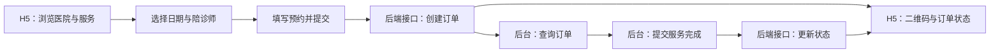

<div align="center">

# 安馨陪诊 · Care Companion

### 让预约更有序，让陪伴更安心。

面向陪诊服务场景的双端 Vue 3 前端作品：连接用户预约与后台服务管理。


[项目亮点](#项目亮点) · [功能地图](#功能地图) · [本地运行](#本地运行) · [代码导航](#代码导航)

</div>

## 项目概览

当用户需要就诊陪同，预约信息、医院、服务时间与陪诊师需要有序衔接。本项目围绕这一场景实现两套独立前端：**H5 用户端负责服务浏览与预约，管理后台负责陪护师、订单和访问菜单管理**。

作品重点在于将业务流程落到页面交互、路由权限、请求封装和可复用组件中，展示从移动端到运营后台的前端实现能力。

> **项目范围**：本仓库包含前端源码，不包含服务端、数据库、短信服务或支付商户配置。完整业务体验需要兼容的后端接口；支付二维码由接口返回的数据生成，支付确认和订单状态变更由后端负责。控制台页面目前为占位页，未实现数据可视化看板。

## 项目亮点

- **双端业务衔接**：以用户预约、订单查询和后台服务处理为主线，将移动端与管理端放在同一业务语境中。
- **由权限数据驱动的后台导航**：根据接口返回的菜单配置，通过 `import.meta.glob` 匹配页面，再动态注册路由；配合树形菜单配置、侧边栏和页签导航组织访问入口。实际数据访问权限需由后端校验。
- **面向移动场景的预约交互**：使用 Vant 选择器与弹出层完成医院、日期和陪诊师选择，并校验接送地址、联系方式与服务需求。
- **订单状态表达**：区分待支付、待服务、已完成与已取消状态，结合详情页、倒计时组件和二维码弹窗呈现不同阶段。
- **统一请求与登录态处理**：Axios 实例集中管理请求超时、终端标识、Token 请求头和登录过期处理；双端使用不同的登录态存储键。
- **可复用的后台布局**：拆分侧栏、树形菜单、顶部导航与页面标题组件，结合 Vuex 和持久化插件管理菜单与布局状态。

## 功能地图

| 端 | 模块 | 已有前端实现 |
| --- | --- | --- |
| H5 用户端 | 服务首页 | 轮播展示、服务入口、医院列表 |
| H5 用户端 | 预约下单 | 医院 / 日期 / 陪诊师选择、接送地址、联系电话、需求填写 |
| H5 用户端 | 订单中心 | 订单列表、详情、状态展示、待支付倒计时、支付二维码弹窗 |
| H5 用户端 | 个人中心 | 登录、用户信息展示、退出登录 |
| 管理后台 | 账号与菜单 | 登录注册、验证码请求、账号管理、树形菜单权限配置 |
| 管理后台 | 陪护师管理 | 列表、分页、新增、编辑、头像选择、删除 |
| 管理后台 | 订单管理 | 订单查询与分页、服务完成状态提交 |
| 管理后台 | 导航布局 | 动态路由、侧栏折叠、页签导航、登录守卫 |



## 技术栈

| 层级 | 技术 |
| --- | --- |
| 视图与构建 | Vue 3、Composition API、`<script setup>`、Vite 5 |
| 管理端 | Element Plus、Vuex 4、vuex-persistedstate、Day.js |
| 移动端 | Vant 4、qrcode |
| 公共能力 | Vue Router 4、Axios、Less、组件与 API 自动导入 |

## 本地运行

建议使用 Node.js 22 LTS 与 npm。两端分别安装依赖、分别启动，无需在仓库根目录安装。

```bash
git clone https://github.com/jiefengdelutai/pz_project.git
cd pz_project
```

**1. 配置接口**

分别将 `pzadmin/.env.example`、`pzH5/.env.example` 复制为各自目录下的 `.env.local`，填写兼容后端的公开 API 地址，例如：

```dotenv
VITE_API_BASE_URL=http://localhost:3000/v3pz
```

后端需要允许两个开发站点的跨域访问，并提供 `src/api` 中定义的接口。管理端发送 `x-token`，移动端发送 `h-token` 及 `terminal: h5`。环境配置改动后请重启开发服务。

**2. 启动管理后台**

```bash
cd pzadmin
npm ci
npm run dev
```

默认访问 `http://localhost:5173`，以终端实际输出为准。

**3. 在另一个终端启动 H5 用户端**

```bash
cd pzH5
npm ci
npm run dev
```

默认访问 `http://localhost:5500`；可在浏览器开发者工具中切换为移动设备尺寸。

没有后端时可以启动前端并查看登录界面，业务数据、登录和下单等功能无法完整使用。本仓库不提供真实账号或支付凭据。

## 构建与部署

在两个应用各自目录中执行：

```bash
npm run build
npm run preview
```

构建结果分别位于 `pzadmin/dist` 和 `pzH5/dist`，可独立部署到静态站点。两端使用 Hash 路由。部署前设置各自的 `VITE_API_BASE_URL`，再重新构建；生产环境还需配置 HTTPS、API 跨域和后端鉴权。

## 代码导航

```text
pz_project/
├── pzadmin/                 # 管理后台
│   ├── src/api/             # 账号、菜单、陪护师与订单接口
│   ├── src/components/      # 侧栏、树形菜单、顶部导航、标题
│   ├── src/router/          # 基础路由
│   ├── src/store/           # 动态菜单、页签与布局状态
│   ├── src/utils/           # Axios 请求与登录过期处理
│   └── src/views/           # 登录、账号、菜单、陪护师、订单
├── pzH5/                    # 移动端
│   ├── src/api/             # 首页、预约与订单接口
│   ├── src/components/      # 订单状态栏与倒计时
│   ├── src/pages/           # 首页、登录、预约、订单、个人中心
│   ├── src/router/          # 页面路由
│   └── src/utils/           # 移动端请求封装
└── README.md
```

建议从以下入口阅读实现：

- [动态菜单与页面匹配](pzadmin/src/store/menu.js)
- [后台登录守卫与路由恢复](pzadmin/src/main.js)
- [移动端预约表单与二维码生成](pzH5/src/pages/createOrder/index.vue)
- [订单详情与状态呈现](pzH5/src/pages/detail/index.vue)
- [管理端请求封装](pzadmin/src/utils/request.js)

## 配置与隐私

- 仓库提供 `.env.example`，忽略本地环境文件、依赖、构建输出和临时配置。
- `VITE_*` 变量会进入浏览器产物，只能放公开配置，不能存放密钥、账号密码或私有 Token。
- 已移除输出订单、接口响应和表单内容的调试日志。展示或录屏请使用虚构姓名、电话、地址及订单数据。
- 前端路由控制用于界面访问体验，后端仍需对每个业务接口实施权限校验。

## 关于作者

**Rice!** · 前端开发作品集

关注业务流程、双端交互与可维护的 Vue 组件组织。欢迎通过 [GitHub Issues](https://github.com/jiefengdelutai/pz_project/issues) 交流实现思路与改进建议。
